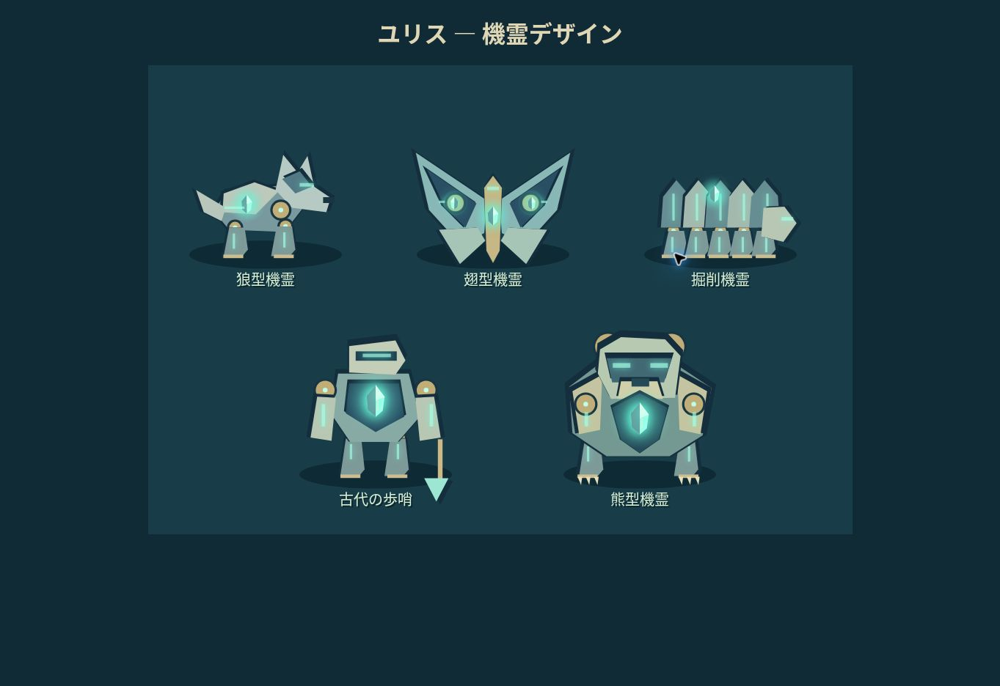

# ユリスと眠れる古代文明 — 星灯りの坑道

「ユリスと眠れる文明」の設定をもとにした、独立したゲームオリジナル短編RPG。HTML / CSS / JavaScript、外部ゲームエンジン不要。Canvas描画によるオリジナルのピクセル風アートとWeb Audio音楽。

## 遊び方
- 行きたい場所をタップすると、障害物を避けて目的地まで自動で移動。人・宝箱・出口をタップすると、隣まで移動して自動で話す／調べる。
- キーボードでは矢印キー / WASD も利用可能。別の場所のタップや方向操作で行き先を変更。会話・戦闘・メニュー・画面非表示で移動停止。
- キーボードでは Enter / E / Space でも隣接した対象を調べる。スマホの方向ボタンと「話す・調べる」ボタンは廃止し、タップ操作に統一。
- Jで手帳。メニューで記録・セーブの書き出しと読み込み。
- 音は初期OFF。右上で有効化。

## 収録内容
5エリア、ユリス・エド・ノア、行動予告つきターン制バトル、歩行中のランダムエンカウント（森・坑道・遺跡）、5種の敵、装備強化、薬草、レベル、2件の寄り道、4件の記録、3つの弁の謎解き、熊型機霊の救出、エンディングとクリア後探索。

戦闘敗北で所持品を失わず町へ帰還。雑魚戦からの退却は必ず成功。町と各探索エリアに無料の全回復地点あり。戦闘中の自動保存は行わず、直前の状態を保持する。

## 設定と脚色
2026-11-06時点のGoogle Drive「設定資料_ユリスと眠れる文明」を参照。ユリスは栗色の髪の少女領主、エドは紺色の上着、ノアは独立した小型の四足の身体。機霊との共感覚はノアとの接触と双方の了承を伴う。ノアの一人称は「私」、呼称は「マスター」。白鹿は人工機霊ではないため本作の敵に含めない。「解析」の魔法は保留のため採用しない。

本編の出来事を逐語的に再現するものではない。場所の配置、敵、寄り道、具体的な弁の順序、数値、未確定の配色はゲーム用脚色。原作の正本は変更していない。

## 開発
`dist/` を静的HTTPサーバーで配信。`index.html` はESモジュールを読むため file:// での直接起動には非対応。

- `dist/core.js` 戦闘・状態・セーブ検証
- `dist/world.js` マップと当たり判定
- `dist/render.js` Canvas描画
- `dist/game.js` UIとイベント
- `dist/style.css` レスポンシブUI

検証：`npm test`（戦闘・マップ、タップ経路、エンカウント、通しイベント、PWA）。
前者は到達可能性と80種の乱数系列での戦闘を検証。後者は簡易DOMを用いて実際のゲームイベントを490歩の経路で通し、ランダム戦闘14回、採集、修復、弁、機霊救出、エンディング、記録保存を検証する。実ブラウザでは起動・移動・会話・依頼・戦闘・保存再開を確認。

## 正本と公開
ソースの正本は https://github.com/shimizutom1981-ship-it/yuris-rpg です。
GitHub Pages用ワークフローは、テスト成功後に `dist/` を配信します。Settings → Pages → Source は「GitHub Actions」に設定済みです。

公開URL：https://shimizutom1981-ship-it.github.io/yuris-rpg/

既存のChatGPT Sites版とは自動同期されません。ブラウザの保存領域も公開先ごとに別です。旧サイトのメニューでセーブを書き出し、新サイトで読み込むと冒険を引き継げます。

## 作業記録
2026-11-06 JST / ChatGPT / 原作設定確認、5エリアの短編RPG、戦闘・謎解き・セーブ・エンディング実装、経路と戦闘・通し検証 / 残り：ユーザープレイによる難易度と演出の調整。
2026-11-06 JST / ChatGPT / GitHubへ全ソース・テストを登録、Pages初回設定と公開完了、GitHub Actionsのテストとデプロイ成功を確認 / 残り：ユーザープレイによる調整。

## アプリとして追加・オフライン
ゲーム下部の「アプリとして追加」から対応ブラウザのインストール操作を案内します。Android / PCの対応ブラウザではインストールの提案が出ることがあります。iPhone / iPadはSafariの共有メニューから「ホーム画面に追加」。
初回オンライン読み込み後、「オフライン準備完了」が出ると通信なしで再起動・プレイできます。音と画像はローカル生成、外部フォント依存なし。追加やインストールの最終操作はユーザーが行います。

セーブはこれまでと同じlocalStorageキーを維持します。旧セーブは自動で互換読み込みされます。異なる端末／ブラウザへはセーブJSONの書き出しと読み込みを使用してください。ブラウザのデータ削除でセーブが消えるため、長期保存は書き出しを推奨します。

Service Workerはゲームのサブパスだけを管理し、他のGitHub Pagesアプリのキャッシュを削除しません。全ファイルを一括でキャッシュし、途中の戦闘を強制再起動しません。「更新あり」が表示された場合は、セーブしてゲームの全ウィンドウ・タブを閉じ、開き直すと新しい版に切り替わります。

2026-11-06 JST / ChatGPT / タップ経路移動・自動会話、歩行ランダム遭遇、安全歩数、旧セーブ互換、PWAとオフライン一括キャッシュを追加。経路760項目、戦闘・マップ859項目、14戦の通しプレイ、オフライン応答とキャッシュ分離を検証 / 残り：各実機でのインストール操作はユーザー実施。

### グラフィック更新
2026-11-06 / ChatGPT / 機霊5種を霊晶・関節・発光回路を持つ造形に更新。人物のマント・装飾、森の光、高解像度描画を追加。全テスト通過 / 実端末でのインストール操作は利用端末で実施。

### 戦闘表示とスマホ操作の修正（1.1.1）
戦闘のログ・コマンドを敵の描画領域の下へ分離し、文章が増えても敵を隠さない構成に変更。敵の描画サイズを拡大。スマホのヘッダーと左右余白を縮め、方向ボタン・「話す・調べる」ボタンを削除。地図タップによる移動・会話・調査、キーボード操作、既存セーブ互換は維持。

検証：戦闘・マップ859項目、タップ経路など760項目、全編の実コールバックを通す統合テスト、PWA、HTML構造・戦闘パネル分離テストが通過。統合テストはボタン削除後のキーボード移動と対象タップを使用。今回の実ブラウザによる画面確認は検証環境の制約で未実施。iPhone / Android実機も未確認。

既存のオフライン版は旧キャッシュを保持することがあります。「更新あり」になったら戦闘を終えてセーブし、ゲームの全タブ・アプリ画面を閉じて開き直してください。データ削除は不要です。

## 1.2.0 — 第二話「風の記憶」と戦闘拡張

第一話のクリア済み記録で「つづきから」を選び、町のヴィクトルに話しかけると第二話が始まります。第一話のクリア画面からも開始可能。風見の峠 → 沈黙の水路 → 風の中継塔の3マップ、調査員ミラ、調律の謎解き、新しい守り手、町への報告までを追加しました。ゲーム独自の短編で、小説正本の設定追加ではありません。

- 敵は最大3体。対象ボタンで単体攻撃の相手を選択。倒れた敵は行動しません。
- スキル：踏み込み（単体）、旋風斬り（全体）。
- 魔法：霊光の波（全体・装甲無視）、癒しの光（二人回復・エド復帰）、守護の幕（被害軽減）、勇気の詠唱（攻撃強化）、霊鎖（敵1体の攻撃低下）。
- 補助効果は3ターン。守護と霊鎖は使用ターンを含み、勇気は次の3ターン。残り時間を表示。効果は戦闘終了で解除。
- 熟練度：剣技・攻撃魔法・回復魔法・補助魔法。各系統の成功した使用回数5/15/30/50でLv2/3/4/5。攻撃・回復は1段階につき12%強化、補助も効果が強化。冒険手帳で確認可能。
- 初期セーブのキーとバージョンを維持。旧記録では熟練度を0から補完し、進行・装備・アイテムを引き継ぎます。
- オフライン更新：オンラインで開き「更新あり」を確認後、全タブとインストール済みアプリを閉じて開き直してください。データ削除は不要です。

検証：`npm test`。マップ・旧戦闘883項目、経路・遭遇・互換1013項目、第一話から第二話の報告まで実ゲームコールバックで747歩、両話のクリアと7記録・熟練度保存を確認。魔法の範囲・対象、回復と復帰、補助効果と期限、熟練成長、旧セーブ、60乱数系列の群れ戦闘、PWAとUI構造も検証。実ブラウザではテストセーブ読み込み、3体遭遇、全体魔法・回復魔法・守護の幕の実行を確認。スマホ実機での操作確認は未実施。

2026-11-07 / ChatGPT / 第二話、複数敵・対象選択、全体/回復/補助魔法、スキル、熟練度、既存記録の引継ぎを実装・検証 / 実端末での継続プレイとバランスの感想を反映。
